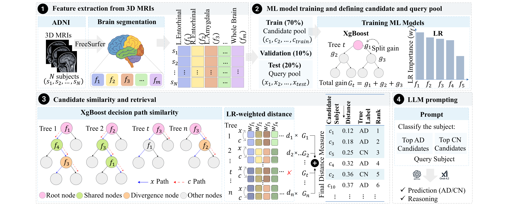

# ML-Guided Example Selection for LLM-Based Alzheimer's Disease Classification

This repository contains the code used for Alzheimer's disease classification using MRI-derived FreeSurfer features and large language models.

The study evaluates different in-context learning example-selection methods, including Random, Cosine similarity, Euclidean distance, Delta-kNN, and the proposed ML-guided method.

## Framework




## Overview

Machine learning (ML) models can classify Alzheimer's disease (AD) from MRI-derived features, but they offer limited natural-language explanation of how multiple anatomical measurements support an individual decision. Large language models (LLMs) can produce both predictions and reasoning from structured measurements, and few-shot in-context learning (ICL) adapts them to the task without parameter updates. However, ICL performance depends strongly on which examples are placed in the prompt.

This work proposes an **ML-guided example-selection method** that uses lightweight supervised models (logistic regression and XGBoost) to learn discriminative feature-label relationships from labeled data, and uses them to select informative demonstrations without any additional LLM inference.

### Main contributions

1. An ML-guided selection strategy combining task-relevant logistic regression (LR) and XGBoost (XGB) information to identify informative examples.
2. Improved classification over zero-shot and baseline example-selection methods with GPT5.4.
3. Analysis of LLM-generated reasoning for consistency, biological and directional validity, and variation with the selected ICL examples.

## Method

The framework combines two complementary signals:

- **Logistic regression (LR):** provides global, class-discriminative feature importance. Each retained feature `f` receives a normalized weight `w_f = |β_f| / Σ_j |β_j|`.
- **XGBoost (XGB):** provides local, subject-specific nonlinear relationships through decision paths.

For a query subject `x` and a candidate `c`:

1. Decision paths through the trained XGB ensemble are precomputed once for all subjects.
2. In each tree, the **shared path** is the run of consecutive split nodes from the root where both subjects follow the same branch, ending at their first divergence.
3. A per-tree distance `d_t(x, c)` is computed as an LR-weighted Euclidean distance over the features encountered along the shared path (using standardized feature values).
4. Per-tree distances are weighted by each tree's total split gain `G_t` and aggregated into the final distance `D(x, c)`.
5. Candidates are ranked **separately within the AD and CN classes** by ascending `D(x, c)`, and the top-`k` from each class are used as ICL examples.

## Dataset

- **Source:** Alzheimer's Disease Neuroimaging Initiative (ADNI), T1-weighted 3D MRI acquired at 1.5T.
- **Subjects:** 313 (145 AD, 168 CN), initial visit only (one scan per subject).
- **Features:** Processed with FreeSurfer (Desikan-Killiany cortical parcellation and automated subcortical segmentation) to extract hemisphere-specific volume and cortical thickness from 59 brain regions, plus age and gender, giving 176 features per subject.
- **Split (70:10:20):**

| Split | Total | AD | CN |
|---|---|---|---|
| Train | 220 | 102 | 118 |
| Validation | 30 | 14 | 16 |
| Test | 63 | 29 | 34 |

> ADNI data cannot be redistributed. Access must be requested at [adni.loni.usc.edu](https://adni.loni.usc.edu).

## Experimental Setup

- LR and XGB are trained for AD vs. CN classification on the training set, with validation used for cross-validated hyperparameter tuning.
- Training subjects form the candidate pool; test subjects are the queries.
- **LLM:** GPT5.4, 4-shot ICL (`k = 2`: two AD and two CN examples per query).
- Each LLM-selection configuration is run **three times**, and accuracy is computed by majority vote across runs.
- **Baselines:** zero-shot, random, Euclidean, and Delta-kNN.
- GPT4.1 is used to assess reasoning consistency and extract structured information from explanations.

## Results

### Classification performance

| Model | Method | ACC | SEN | SPE | F1 |
|---|---|---|---|---|---|
| LR | ML | 87.30 | 89.66 | 85.29 | 86.67 |
| XGBoost | ML | 87.30 | 86.21 | 88.24 | 86.21 |
| GPT5.4 | Zero-shot | 84.13 | 79.31 | 88.23 | 82.14 |
| GPT5.4 | Random | 84.13 | 86.21 | 82.35 | 83.33 |
| GPT5.4 | Euclidean | 84.13 | 86.21 | 82.35 | 83.33 |
| GPT5.4 | Delta-kNN | 85.71 | 82.76 | 88.23 | 84.21 |
| GPT5.4 | **Proposed** | **90.48** | 82.76 | **97.06** | **88.89** |

### Ablation study

| Method | ACC | SEN | SPE | F1 |
|---|---|---|---|---|
| LR | 87.30 | 89.65 | 85.29 | 86.67 |
| XGB path | 85.71 | 79.31 | 91.18 | 83.63 |
| XGB path + Gain | 87.30 | 79.31 | 94.12 | 85.18 |
| **LR + XGB path + Gain** | **90.48** | 82.76 | 97.06 | 88.89 |

LR weighting contributes more to sensitivity, while the XGB-based components favor specificity.

### Statistical significance

The improvements are numerical only. McNemar tests against the baselines were not significant after Holm correction (all adjusted p = 0.875), and the ablation showed no significant overall difference (Q = 3.50, p = 0.174).

### Additional LLM (Grok4.2)

| Method | ACC |
|---|---|
| Zero-shot | 68.25 |
| Random | 76.19 |
| Euclidean | 82.54 |
| Delta-kNN | 79.36 |
| **Proposed** | **84.13** |

## Interpretability

- **Reasoning consistency:** Stable predictions across repeated runs were mostly accompanied by consistent reasoning. Reasoning inconsistency was more common when predictions varied.
- **ML regional importance:** LR coefficients and XGB gain, aggregated by brain region, highlight AD-relevant areas such as the entorhinal cortex, hippocampus, and inferior temporal cortex.
- **LLM reasoning:** GPT5.4 frequently referenced the hippocampus, entorhinal cortex, ventricles, parahippocampal gyrus, and whole brain, covering a broader range of regions than the ML models. It also grouped measurements into concepts such as the medial temporal lobe and ventricles.
- **Directional validity:** Reduced measures were mostly associated with AD, preserved measures with CN, and increased measures (particularly ventricular) with AD.

## Repository Structure

> TODO: update to match your repo.

```
.
├── data/              # Feature tables (ADNI data not included)
├── figures/           # Framework and result figures
├── src/               # Selection methods, prompts, evaluation
├── notebooks/         # Analysis notebooks
├── requirements.txt
└── README.md
```

## Installation

> TODO: update commands.

```bash
git clone https://github.com/thisara-kumarasiri/ADLLM-ICL.git
cd ADLLM-ICL
pip install -r requirements.txt
```

## Usage

> TODO: add your actual scripts and arguments.

```bash
# 1. Extract features / prepare data
python prepare_data.py

# 2. Train LR and XGBoost and compute example rankings
python select_examples.py --method proposed --k 2

# 3. Run LLM inference
python run_icl.py --model gpt-5.4 --method proposed --runs 3
```

An OpenAI API key is required for LLM inference:

```bash
export OPENAI_API_KEY="your-key"
```

## Limitations

- Experiments use a single ADNI cohort and primarily one LLM (GPT5.4, with an additional Grok4.2 check), which may limit generalizability.
- Reasoning analysis reflects generated explanations, not clinically validated causal interpretations.
- Accuracy gains are not statistically significant on the current test set.

Future work will evaluate the framework on larger and external cohorts, additional LLMs, and broader neuroimaging settings.

## Citation

> TODO: update once published.

```bibtex
@inproceedings{kumarasiri2026mlguided,
  title     = {Improving Demonstration Selection for Interpretable LLM-Based Alzheimer's Disease Classification from MRI-Derived Features},
  author    = {Kumarasiri, Thisara and He, Estrid and Alavi, Azadeh and Sarwar, Tabinda and Sanjeewani, Pubudu},
  year      = {2026}
}
```

## Acknowledgments

Data collection and sharing for this project was funded by the Alzheimer's Disease Neuroimaging Initiative (ADNI) (National Institutes of Health Grant U01 AG024904) and DOD ADNI (Department of Defense award number W81XWH-12-2-0012).

## License

> TODO: add license (e.g. MIT).
